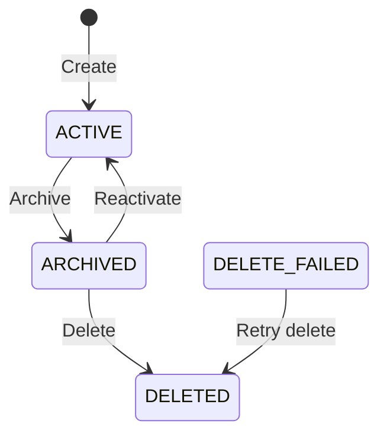

# Namespace Management Guide

Namespaces are the top-level organizational unit in Context Ontology Accelerator. Each namespace is an isolated workspace containing data sources, ontologies, metrics, and access grants. Under the hood, each namespace maps 1:1 to an Amazon DataZone project.

!!! tip "Full request/response schemas"
    This guide shows the workflow and key behaviors. For the complete request/response schema, every field, and status codes for each endpoint below, see the **[API Reference](#/api-reference)** (Control Plane API → Namespace management) — it's generated directly from the API contract and always current.

## Creating a Namespace

### Via Web UI

1. Navigate to **Administration → Namespaces**
2. Click **Create namespace**
3. Fill in:
   - **Name** — unique identifier (lowercase, hyphens allowed, max 64 chars)
   - **Display name** — human-friendly label
   - **Description** — purpose of this namespace
   - **Owner** — email of the initial owner (will receive `namespace-owner` role automatically)
   - **Language** — **English (en)** (default) or **Japanese (ja)**. Text COA
     generates (descriptions, synonyms, and labels for document sources) uses
     this language; source text and table and column names are kept as-is.
     The language cannot be changed later (see
     [Namespace Language](#namespace-language))
4. Click **Create namespace**, check the language in the
   **Confirm namespace language** dialog, then click **Confirm and create**

### Via API

`POST /namespaces` with `name`, `displayName`, `description`, `owner` and an
optional `language` —
see **CreateNamespace** in the [API Reference](#/api-reference) for the full
request/response schema. Returns `201 Created` with the new namespace
(`namespaceId`, `status: ACTIVE`, `language`, `dataZoneProjectId`,
`athenaWorkgroupName`, etc.).

### Namespace Language

`language` is the language your sources are written in. COA uses it for the
text it generates for that namespace, such as descriptions and synonyms. It is
fixed when the namespace is created.

- **Format:** `language[-script][-region]` — language is 2–8 letters, script is
  4 letters, region is 2 letters or 3 digits. Examples: `en`, `ja`, `pt-BR`,
  `es-419`, `zh-Hant`. Variants, extensions and private-use subtags are
  rejected with `400`. This is a subset of the BCP 47 tag format; see
  [BCP 47 language tag](https://developer.mozilla.org/en-US/docs/Glossary/BCP_47_language_tag)
  for how tags are built and the
  [list of common primary language subtags](https://en.wikipedia.org/wiki/IETF_language_tag#List_of_common_primary_language_subtags)
  to find the code for your language.
- **Canonical form:** surrounding spaces are trimmed and case is normalized, so
  ` JA-jp ` is stored and returned as `ja-JP`.
- **Default:** omitting `language` creates an English (`en`) namespace.
- **Immutable:** `UpdateNamespace` has no `language` member. To use another
  language, create a new namespace and onboard the sources there.
- **In responses:** every namespace response includes the effective
  `language`. Namespaces created before this field existed report `en`.
- **For API clients:** the change is additive. Requests are unchanged
  (`language` on **CreateNamespace** is optional and defaults to `en`), so an
  existing caller keeps working. `language` is a required member of
  `NamespaceSummary` (**ListNamespaces**) and `NamespaceDetail` (**CreateNamespace**,
  **GetNamespace**, **UpdateNamespace**, **UpdateNamespaceStatus**), so it is
  always present and never needs a null check. To read it from a typed client,
  regenerate the client from the Smithy models (`make generate`, see
  [Smithy Code Generation](smithy-codegen.md)); the console already uses it.
- **Languages in the console:** the console offers English (`en`) and
  Japanese (`ja`), the two languages tested end to end, and shows each
  namespace's language on the namespace list and detail pages. The API
  accepts any tag in the format above. In a namespace of another language,
  COA gives the model the same instruction to write in the namespace
  language, so the text listed under
  [What the language changes](#what-the-language-changes) as generated in
  the namespace language should come out in it; only English and Japanese
  are tested end to end. Two things differ from English and Japanese:
  - The fixed text COA adds itself, such as foreign-key notes, fallback class
    descriptions and default proposal titles, stays English, so a proposal
    can mix English boilerplate with generated text in your language.
  - Only Korean (`ko`) and Chinese (exactly `zh`) generated text carries an
    RDF language tag (see
    [Namespace language](ontologies.md#namespace-language) in the ontology
    guide). Other languages produce untagged literals. COA still shows them,
    because the language never filters a label out, but a SPARQL query or RDF
    tool that filters with `lang()` or `langMatches()` will not find them,
    and if a resource also has another untagged label, COA picks between the
    two in lexical order instead of preferring the generated one.

#### What the language changes

- **Generated in the namespace language:** descriptions, synonyms, glossary
  terms and tags from database enrichment (see
  [Language of Generated Metadata](sources.md#language-of-generated-metadata));
  propositions, topics, entity classes, entities and relationships extracted
  from documents (see
  [Language of Extracted Content](sources.md#language-of-extracted-content));
  and class descriptions, foreign-key notes and default proposal titles from
  ontology induction (the fixed parts of foreign-key notes and proposal titles
  exist in English and Japanese only, see above).
- **Kept as they are:** table and column names, catalog comments, document
  text, metadata a steward wrote, and identifiers such as model numbers,
  product names, units and codes. COA does not translate them.
- **Always English:** console text, API error messages, and platform
  vocabulary in the ontology such as `matchConfidence`.
- **Queries:** nothing is translated at query time. When a class or property
  has a label in the namespace language next to an untagged one, query context
  and the graph views use the namespace-language label; no resource is hidden
  because of its language. A Tier 3 answer is written in the language of the
  question.

### What Happens on Create

When you create a namespace, the platform:

1. Reserves the name (prevents duplicates)
2. Creates a DataZone project in the configured domain
3. Provisions an Athena workgroup for query isolation
4. Copies built-in role templates into the namespace
5. Grants the `namespace-owner` role to the specified owner

## Retrying Creates Safely

Create calls accept an optional `clientToken` in the request body: 1–64
printable ASCII characters with no spaces (a UUID works well). Retrying the
same request with the same token within 24 hours returns the original response,
marked with the `X-Idempotent-Replay: true` header, instead of creating a
duplicate.

- Reusing a token with different parameters, or while the first call is still
  running, returns `409`.
- A call that failed (any non-2xx response) is not recorded, so a retry with the
  same token runs it again.
- If retry protection is temporarily unavailable, the call returns `503` and
  nothing is created; retry later with the same token.
- Tokens are scoped to the caller, the operation, and the namespace, and expire
  after 24 hours.

Operations that accept `clientToken`: CreateNamespace, CreateGrant,
CreatePlatformGrant, CreateMetric, ImportOsi, CreateSource, RescanSource,
StartInduction, IngestOntologyFromS3, LoadFoundationalOntology,
InferConstraints, and ValidateProposal.

## Namespace Lifecycle

Namespaces follow a defined lifecycle with controlled state transitions:



| Status | Description |
|--------|-------------|
| `ACTIVE` | Fully operational — sources can be connected, queries can run |
| `ARCHIVED` | Frozen — **mutating** operations (managing sources, ontologies, metrics, grants, roles) are blocked; reads and queries still work. Data is retained for audit. |
| `DELETED` | Permanently removed — all resources cleaned up |
| `DELETE_FAILED` | Deletion partially failed — retry the delete to resume |

> **Enforcement:** the mutation block on `ARCHIVED` namespaces is enforced
> centrally in the API Gateway Cedar authorizer (a `forbid` policy that
> overrides all roles, including `platform-admin`). To make changes again,
> reactivate the namespace first.

### Archiving and Reactivating a Namespace

Both use `PATCH /namespaces/{namespaceId}/status` with `{ "status": "ARCHIVED" }`
or `{ "status": "ACTIVE" }` — see **UpdateNamespaceStatus** in the
[API Reference](#/api-reference).

## Updating a Namespace

`PUT /namespaces/{namespaceId}` updates display name, description, or owner
— see **UpdateNamespace** in the [API Reference](#/api-reference) for all
updatable fields.

## Deleting a Namespace

Deletion is destructive and asynchronous. Calling `DELETE` starts a Step
Functions pipeline that cascades through and removes **all** of the
namespace's resources — sources, metrics, ontology data, and the underlying
AWS resources (Athena workgroup, DataZone project, VKG service, Cloud Map
entries, role mappings, and role definitions) — before deleting the namespace
record itself. You do **not** need to delete sources, ontologies, or metrics
yourself first; the pipeline deletes all child resources for you.

### Prerequisites

Before deleting, the namespace must be:

1. **Archived (or already `DELETE_FAILED`)** — only `ARCHIVED` or
   `DELETE_FAILED` namespaces can be deleted; `ACTIVE` namespaces must be
   archived first (see "Archiving and Reactivating a Namespace" above)

That's the only precondition on the namespace's *contents*. The only thing
that can still block the call is something **actively in-flight** right now
— a source mid-scan/enrichment, an ontology induction/ingest job that hasn't
reached a terminal state, or a metric import job still `IN_PROGRESS` — since
deleting a child resource out from under a job that's still writing to it
would race. Merely *having* sources, ontologies, or metrics does not block
deletion; those are removed by the pipeline itself.

### Delete

`DELETE /namespaces/{namespaceId}` — see **DeleteNamespace** in the
[API Reference](#/api-reference).

Returns `202 Accepted` immediately — deletion runs in the background. Poll
`GET /namespaces/{namespaceId}` for the namespace's `status`, which
transitions `DELETING` → `DELETED` on success (the namespace then 404s once
its record is removed) or `DELETING` → `DELETE_FAILED` if a step fails after
exhausting retries.

If something is still actively running, you'll receive a `409 Conflict`
instead of starting the pipeline:

```json
{
  "message": "Cannot delete namespace: 2 source(s) actively scanning or enriching. Wait for these jobs to finish.",
  "blockers": ["2 source(s) actively scanning or enriching"]
}
```

Wait for the in-flight job(s) to reach a terminal state, then retry the
`DELETE` call.

### Deletion Pipeline

The pipeline runs these steps in order, each with 3 retries (exponential
backoff) before giving up:

1. **Delete Sources** — deletes all data sources in the namespace via the
   Sources API
2. **Delete Metrics** — deletes all metrics via the Metrics API
3. **Delete Ontology** — tears down ontology graph data and artifacts via the
   ontology engine
4. **Delete Platform Resources** — Athena workgroup, DataZone project, VKG
   ECS service, Cloud Map service-discovery entries, role mappings, and role
   definitions
5. **Finalize** — deletes the namespace record and releases its name
   reservation

Steps 1–4 are best-effort and retried — the underlying cleanup calls are
already designed to be safe to retry (idempotent against a resource that's
already gone). **Finalize is the only step that must succeed outright**: if
it fails, the namespace stays visible (rather than silently vanishing while
"mostly" deleted) so it remains retryable.

If **any** step exhausts its retries, the namespace lands in `DELETE_FAILED`.
Simply retry the `DELETE` call — the pipeline resumes from the beginning, and
steps for resources that are already gone are no-ops.

## Listing Namespaces

`GET /namespaces`, paginated via `maxResults`/`nextToken` — see
**ListNamespaces** in the [API Reference](#/api-reference) for the full
parameter and response shape.

All authenticated users can list namespaces (the default Cedar policy permits `list` for all users). However, accessing a namespace's resources requires an explicit role grant.

## Namespace Resources

Once a namespace is created, you can connect:

| Resource | Description | Guide |
|----------|-------------|-------|
| Database sources | Glue Data Catalog or JDBC databases | Connect via Sources page |
| Document sources | S3 buckets or file uploads | Connect via Sources page |
| Ontologies | OWL knowledge graphs | Ontology management |
| Metrics | Governed SQL metric definitions | Metrics page |

## VKG Health Monitoring

When a namespace has an accepted ontology, the platform provisions a Virtual
Knowledge Graph (VKG) service that answers graph/SPARQL queries. `GetNamespace`
reports the current state of that service in two fields:

- **`vkgHealth`** — one of five `VkgHealthStatus` values (below). Surfaced in the
  namespace detail view in the web UI.
- **`vkgHealthReason`** — an optional, human-readable string present **only when
  `vkgHealth` is not `HEALTHY`**. It gives a short explanation of why the VKG is
  in a non-HEALTHY state so you can act without inspecting ECS directly (e.g.
  `"container health check failing"` for `DEGRADED`, `"no running task"` for
  `UNAVAILABLE`). For `HEALTHY` namespaces the field is absent.

| `vkgHealth` | Meaning | What to do |
|-------------|---------|-----------|
| `HEALTHY` | A running VKG task is passing its container health check and can answer queries. | Nothing — normal operation. |
| `DEGRADED` | A VKG task **is running** but its container health check is failing (e.g. Ontop could not load the R2RML mappings, or the OWL2QL translation is not completing). Distinct from `UNAVAILABLE`. | Check the VKG service logs in CloudWatch. Common causes: an under-provisioned task (see [VKG Task Sizing](deploying.md#vkg-task-sizing)) or a malformed mapping. |
| `UNAVAILABLE` | No VKG task is running for this namespace (desired count 0, or all tasks stopped). | Trigger a reload, or check for a failed deployment / circuit-breaker rollback. |
| `PROVISIONING` | A VKG task is starting up or a new deployment is rolling out; health is not yet confirmed. | Wait — this is transient during create/reload. |
| `UNKNOWN` | No VKG service exists for this namespace (e.g. no accepted ontology yet), or the health could not be determined. | Expected before an ontology is accepted; otherwise verify the service was provisioned. |

`DEGRADED` and `UNAVAILABLE` are deliberately **disjoint**: a running-but-broken
VKG reports `DEGRADED` (not a false `HEALTHY` and not `UNAVAILABLE`), so a
silently-broken graph is visible rather than masked.

## Authorization

| Action | Required Role |
|--------|--------------|
| List namespaces | Any authenticated user |
| Create namespace | `platform-admin` only — namespace creation has no existing namespace to scope a `namespace-owner` grant to, so it requires the global role |
| View namespace details | Any namespace role (`namespace-owner`, `data-steward`, `data-analyst`, etc.) |
| Update namespace | `namespace-owner`, `namespace-maintainer`, or `platform-admin` |
| Archive/reactivate | `namespace-owner`, `namespace-maintainer`, or `platform-admin` |
| Delete namespace | `namespace-owner`, `namespace-maintainer`, or `platform-admin` |

See the [Role & Permission Management Guide](role-permission-management.md) for details on granting roles.

## Platform-Wide Roles

Platform roles apply across **all namespaces** without requiring per-namespace grants.

| Role | Description |
|------|-------------|
| `platform-admin` | Full access to all actions on all resources in all namespaces |
| `platform-viewer` | Read-only access across all namespaces (view, query, search) |

## Full Permission Matrix

| Action | platform-admin | platform-viewer | namespace-owner | data-steward | data-analyst |
|--------|:-:|:-:|:-:|:-:|:-:|
| List namespaces | ✅ | ✅ | ✅ | ✅ | ✅ |
| Create namespace | ✅ | ❌ | ❌ | ❌ | ❌ |
| Update namespace | ✅ | ❌ | ✅ | ❌ | ❌ |
| Delete namespace | ✅ | ❌ | ✅ | ❌ | ❌ |
| Manage data sources | ✅ | ❌ | ✅ | ✅ | ❌ |
| Manage ontologies | ✅ | ❌ | ✅ | ✅ | ❌ |
| Manage metrics | ✅ | ❌ | ✅ | ✅ | ❌ |
| Query data | ✅ | ✅ | ✅ | ✅ | ✅ |
| Grant permissions | ✅ | ❌ | ✅ | ❌ | ❌ |
| Manage platform grants | ✅ | ❌ | ❌ | ❌ | ❌ |
