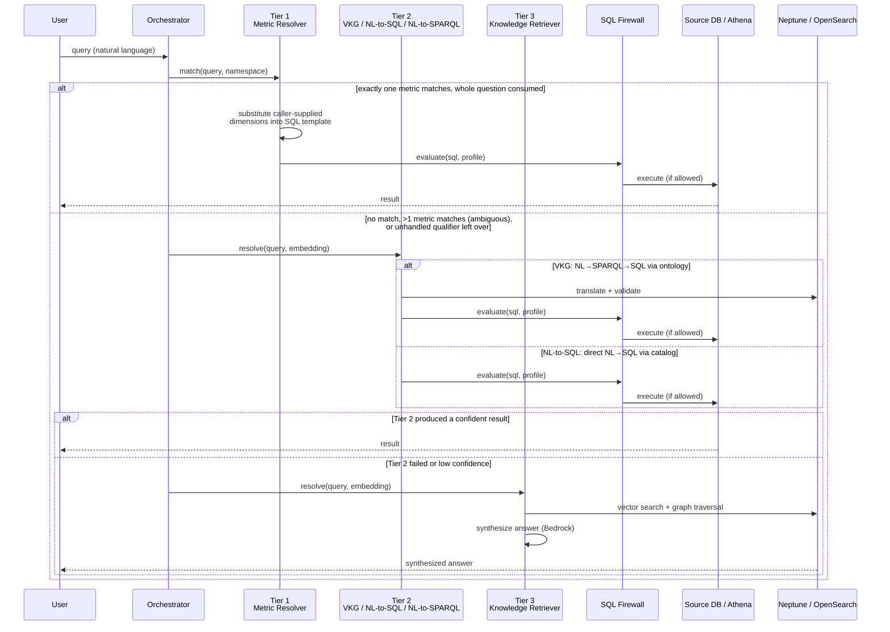

# Serve

The Serve layer is how users and AI agents query Context Ontology Accelerator. It orchestrates across multiple resolution strategies to answer natural language questions using your semantic context — metrics, ontologies, knowledge graphs, and source data.

!!! tip "Full request/response schemas"
    For the complete request/response schema for every Serve endpoint below,
    see the **[API Reference](#/api-reference)** (Data Layer (Serve) API) —
    it's generated directly from the API contract and always current.

## Query Interfaces

### Playground (Web App)

The built-in Playground provides an interactive chat interface:

1. Navigate to **Playground** in the web app
2. Select a namespace
3. Ask questions in natural language

The Playground streams responses in real-time via SSE (Server-Sent Events), showing:

- **Resolution steps**: which strategy is being tried
- **Generated SQL**: the query produced for your data
- **Results**: tables, summaries, or explanations
- **Conversation history**: multi-turn context within a session

### REST API

`POST /namespaces/{namespaceId}/query` with a natural-language `query` and
optional members alongside it in the same JSON body (top-level fields, not
nested under an `options` object) — see **Query** in the
[API Reference](#/api-reference) for the full request/response schema. A member
with the wrong type or outside its documented range is rejected with `400`
rather than clamped or ignored.

Options:
- `execute: false` — return the generated SQL without executing it
- `tierOverride` — force a specific resolution tier (integer 1–3)
- `mode` — choose the execution policy: the Standard tier cascade or Deep
  Reasoning (see below)
- `strategy` — choose which Tier-2 engine answers a structured query (see below)
- `maxResults` — limit result rows (1–10000)
- `includeSupporting` — include supporting context in the response
- `includeDebugInfo` — request the generated `queryUsed` (SQL) and
  `sparqlGenerated` fields in the response. ⚠️ Security: these fields expose
  internal schema, so each is gated independently by exactly the schema it
  reveals — the **SQL** (`queryUsed`, table/column names) on `viewSource`, the
  **SPARQL** (`sparqlGenerated`, ontology class/property names) on
  `viewOntology`. A caller holding a right sees that artifact; a schema-blind
  `data-analyst` (holding neither) sees neither. For a caller lacking a right
  the field is omitted — enforcement is fail-closed and per-artifact. See
  [Schema-blind callers](#schema-blind-callers) for everything else such a
  caller sees differently. The Playground always requests them, so every role
  holding the right sees the SQL/SPARQL under **Compiled artifacts** by default
  and a `data-analyst` never does.
- `includeLlmUsage` — include provider-reported text-LLM token usage in
  `result.llmUsage`. Usage is grouped by exact model ID so an external
  reporting layer can apply its own versioned prices. It contains no prompts,
  answers, credentials, or per-call traces. When enabled, an error response
  may instead include top-level `llmUsage` containing usage recorded before
  the failure. In either response, `complete: false` means at least one known
  LLM call was not fully accounted, so the reported totals may be partial.
  **Off by default.**
- `dimensions` — dimension filters, a list of up to 100 `{name, value}`
  objects (`name` 1–256 characters and unique case-insensitively, `value` up
  to 4000 characters, `operator` only `=`)
- `timeoutMs` — cap the server-side resolution budget for this request, an
  integer from 1 to 29000. It can only *lower* the budget. Over REST the
  answer must also arrive within the REST deadline (about 28 s from when API
  Gateway passes the authorized request on, see below), so a larger value gives no extra
  time. A value outside that range is rejected with `400`.

> **⚠️ REST has a hard 29-second timeout.** The REST endpoint runs behind API
> Gateway, whose integration timeout is a fixed **29 s** (`timeoutInMillis: 29000`)
> that **cannot be raised**. The data layer stops waiting for the Context Manager
> about 1 s before that limit, counted from when the gateway calls the data layer
> after the authorizer has returned (so a data-layer cold start counts against it,
> the authorizer's time does not), so that its own error reaches you instead
> of the gateway's. A query that needs longer does not return over REST — it
> responds with `504`:
>
> ```json
> { "error": "rest_deadline_exceeded", "limitMs": 29000,
>   "message": "Query exceeded the 29s REST timeout ... use the streaming query endpoint ..." }
> ```
>
> This is expected for long-running work — most commonly **Tier 3** knowledge
> synthesis, which routinely takes 20–90 s. The work may still be completing
> server-side; the error means only that it cannot be delivered within the REST
> budget, **not** that the service is down or the query is malformed. For those
> queries, use the **streaming endpoint** (below), which has a much larger budget.
> Fast structured lookups (Tier 1 / Tier 2 single-shot) usually finish well inside
> the REST deadline and are well suited to REST.

### Streaming (recommended for interactive query)

For interactive use — and for any query that may take more than a few seconds
(Tier 3 synthesis, multi-step retrieval) — use the **streaming** path rather than
the synchronous REST endpoint. It POSTs to the AgentCore Runtime `/invocations`
endpoint with SSE (Server-Sent Events) and carries a much larger resolution budget
(**170 s** by default, `resolve_timeout_s`), so it is not subject to the 29 s API
Gateway ceiling. It also streams resolution steps, generated SQL, and results as
they are produced instead of blocking for a single response. (A schema-blind
caller receives step names and timings only, and the answer arrives once, in the
final `done` event — see below.)

### Schema-blind callers

A caller without `viewSource` or `viewOntology` on the namespace — the built-in
`data-analyst` role — gets results, the synthesized answer and confidence, but no
schema. On both REST and streaming:

- **Debug and context fields are empty.** `queryUsed`, `sparqlGenerated`,
  `metadata.retrieved_tables` / `expanded_tables`, `graphContext` entities and
  trace step details are withheld for whichever right is missing. Trace steps keep
  their names and timings.
- **The answer is not streamed token by token.** The redacted final answer arrives
  in the `done` event.
- **Identifiers are redacted from text.** Database-qualified table names from the
  executed SQL and ontology class/property IRIs from the generated SPARQL or the
  graph are replaced with `[redacted]` in the answer, in string values of result
  rows and in supporting content. In a result column built from text in the query
  itself (`SELECT COUNT(*), 'some text' FROM orders`, a `CASE` or `CONCAT` with a
  literal), bare table and column names the model was shown are also redacted, and
  so is any of them the answer repeats. Columns that hold stored data are left as
  they are. This is best-effort for text the model writes in its own words: a bare
  table or column name paraphrased by the model is not detected.
- **Some statements are refused with `403`.** A statement that reads no table
  (`SELECT 'a' UNION ALL SELECT 'b'`, a CTE over constants) or that returns only
  text constants (`SELECT 'customer_id' FROM orders`) can only echo schema names,
  so it is refused. Ask a data question instead.
- **Errors are generic.** An ambiguous-table or firewall refusal says the query was
  refused without naming tables or schemas.
- **Column names still appear** as result-row keys and in `metadata.columns`,
  because they label the data returned. Use a grant's `columnDenylist` to hide a
  column entirely.
- **Session history is re-scrubbed on replay** with the caller's current rights, so
  turns stored before a role change do not reveal schema.

This is the path the [Playground](#playground-web-app) uses, and the recommended
default for building interactive clients. Reserve the synchronous REST endpoint for
short, scriptable calls where a single blocking request is simpler and the work
reliably fits inside the REST deadline (about 28 s).

#### Selecting a Tier-2 engine — `strategy`

Tier 2 can answer a structured question three ways: through the **Ontop/VKG** semantic
path (SPARQL compiled against your R2RML mappings), through **NL→SQL**, or — for a
graph source — through **NL→SPARQL** (SPARQL run on the graph store itself). By default
it tries NL→SQL and falls back to the others. Setting `strategy` pins the choice, which
is how you compare engines or require one path.

Only the engines that fit the namespace's sources run: NL→SQL and Ontop need a SQL
source, NL→SPARQL needs an `RDF_SPARQL` graph source. A pinned value always runs.

| Value | Behaviour |
|---|---|
| `nl_to_sql_first` | NL→SQL, then NL→SPARQL, then Ontop. **The default when `strategy` is omitted.** |
| `ontop_first` | Ontop first, then the others |
| `ontop` | Ontop only — no fallback |
| `nl_to_sql` | NL→SQL only — no fallback |
| `nl_to_sparql` | NL→SPARQL only — no fallback. Needs graph sources turned on at deploy time (`SCL_GRAPH_SOURCES=on`); otherwise the REST `/query` API returns 400 and streaming and MCP requests run the default chain |
| `best` | Run every engine that fits in parallel, return the highest-confidence answer |
| `deep-reasoning` | The bounded tool-use agent only; never reached as a fallback. Does not use `RDF_SPARQL` sources yet |

```json
{ "query": "how many products are there", "options": { "strategy": "ontop" } }
```

Notes:

- **Optional.** Omitting it behaves exactly as before this option existed.
- **Ignored unless the query resolves at Tier 2.** A question answered by a Tier-1
  metric or Tier-3 retrieval is unaffected.
- **An explicit value is never overridden** by automatic tier gating or per-query
  Tier-2 pruning — pinning an engine is treated as intent.
- **Orthogonal to `mode`.** `mode` decides whether the whole Tier 1→2→3 cascade is
  replaced by the Tier-3 reasoning loop; `strategy` decides which engine answers
  *within* Tier 2. Both were called "agentic" before the rebrand, so they are easy to
  confuse. `deep-reasoning` appears in both because it is the same engine reached two
  ways: `mode="deep-reasoning"` replaces the cascade and returns a prose answer, while
  `strategy="deep-reasoning"` keeps Tier-1 metric routing and returns the agent's
  answer in Tier-2 row shape.
- An unrecognised value returns **400** listing the valid ones, rather than silently
  falling back to the default.
- `ontop` requires the namespace to have an accepted ontology with published R2RML
  mappings; without them the pinned engine fails rather than falling back.
- `nl_to_sparql` requires a verified graph source and an uploaded ontology whose
  classes name it. See [Tier 2 — NL-to-SPARQL](#tier-2-structured-query-nl-to-sparql).

#### Standard vs Deep Reasoning — `mode`

`mode` selects the **execution policy** for the whole request. It answers a
different question than `tierOverride` (which tier runs) and `strategy` (which
Tier-2 engine runs): whether the request is resolved by the tier **cascade** at
all, or handed to the Deep Reasoning loop.

!!! warning "Graph sources are not supported yet"
    Deep Reasoning does not query `RDF_SPARQL` graph sources. Use `standard` mode
    for questions about graph data.

| | `standard` (default) | `deep-reasoning` |
|---|---|---|
| **Routing** | Tier 1 → 2 → 3 cascade; the first confident tier answers and later tiers never run | One planning session owns the request; no cascade. **Tier-1 governed metrics are bypassed** — the loop starts without the metric fast path |
| **Available evidence** | The tier that answers sees only its own sources — a Tier-1/2 answer never consults documents | The planner can call NL→SQL and NL→SPARQL structured-query tools (composition-gated), graph traversal, and document retrieval in the same session and synthesize across them |
| **Answer shape** | Rows/tables for Tier 1/2, prose for Tier 3 | Prose synthesis with supporting document content. The structured leg's SQL and data sources are **not** returned as provenance fields today |
| **Latency / cost** | Lowest for structured questions — a Tier-1 hit is a single SQL execution | An iterative reason-act loop with multiple model calls; comparable to Tier-3 synthesis (tens of seconds — use the streaming endpoint) |
| **Guarantees** | Deterministic routing: the same question takes the same path | **Planner-driven**: the loop chooses its tools per sub-question. It is *able* to combine structured and document evidence, but does **not** guarantee both are consulted for every request |

Use `standard` when you want cascade behaviour — deterministic, cheapest-first
routing for questions one layer can answer, including governed Tier-1 metrics.
Use `deep-reasoning` when the answer should *combine* structured data with
document knowledge. The Standard cascade returns one kind of answer per request
(rows from Tier 1/2, or prose from Tier 3), so a question that needs a table
figure *and* a document passage should be sent with `mode: "deep-reasoning"`,
e.g.:

> *"Was last quarter's total revenue consistent with our revenue-recognition
> policy?"* — the planner can run the revenue query through its structured
> tools, retrieve the policy document, and return one synthesized answer. The
> retrieved policy passages come back as supporting content; the structured
> figures are woven into the prose (their SQL is not itemized in the
> response).

Selecting it on each surface:

- **REST / streaming** — `{ "query": "…", "options": { "mode": "deep-reasoning" } }`
- **MCP** — the `query` tool takes the same `mode` value (`standard` or
  `deep-reasoning`). The tool's JSON schema types it as a plain string — the
  valid values are documented in the parameter description, not enforced as a
  schema enum the way `strategy` is.
- **Playground** — the mode toggle above the input box; it sends `options.mode`
  with each query and defaults to Standard.

Behaviour notes:

- **Precedence.** An explicit request value wins over the execution policy
  derived from `TIER3_STRATEGY`. `mode: "standard"` is an explicit opt-out even
  when the deployment default is `deep-reasoning`. An explicit `tierOverride`
  wins over `mode` — it is a direct instruction about which tier to run.
- **Validation.** The only accepted values are `standard` and `deep-reasoning`
  (plus the pre-rename spelling `agentic`, kept for compatibility). Any other
  value is rejected with **400** naming the valid ones, rather than silently
  falling back.
- **When Deep Reasoning is not configured** in the deployment (no reasoning
  retriever built), a `mode: "deep-reasoning"` request is served in Standard mode
  instead of failing; the fallback is recorded in the server logs
  (`deep_reasoning_mode_unavailable`).
- **Source-composition gating still applies**: on a document-only namespace the
  loop's structured tools are withheld; on a database-only namespace its document
  retrieval self-skips.
- Deterministic *always-run-both* joint retrieval (structured + document in one
  guaranteed pass, rather than at the planner's discretion) is roadmap work,
  tracked as issue #417.

#### Deep Reasoning request options

These optional members of the request `options` object tune the Deep Reasoning
loop (`mode: "deep-reasoning"`). They are read on the streaming endpoint; the REST
endpoint forwards only the members listed under [REST API](#rest-api). **A Deep
Reasoning request that leaves an option unset gets the recommended value** below,
the setting these options were measured with. Set an option yourself to change it:
`false` switches a boolean option off, `"planner"` restores the ontology look-up
step, and `prefetchMode: "off"` skips the first pass. An operator can restore the
previous behaviour (every option off unless the request sets it) for the whole
deployment with `DEEP_REASONING_DEFAULT_OPTIONS=off` on the serve runtime (the
CDK context parameter `serve_deep_reasoning_default_options=off`). Because the
REST endpoint forwards none of these options, a REST Deep Reasoning request always
gets the recommended set; that deployment setting is its only switch. A value
of the wrong type is rejected with **400**; a number outside its range is clamped
to it. The document options do nothing on a namespace with
no DOCUMENTS source.

| Option | Type | What it does | When to use it | Latency / cost |
|---|---|---|---|---|
| `ontologyLookupMode` | `"planner"` or `"preload"` (recommended default) | `preload` resolves the namespace ontology once at the start, alongside question decomposition and outside the step budget, and stops offering `ontology_lookup` to the planner | Questions where the planner's first step would be the ontology lookup anyway | Saves a planner step; the ontology is loaded even when the answer does not use it |
| `readDocument` | bool | Offers the planner a `read_document` tool that reads a source document's original text in windows, not only its retrieved chunks. `readDocumentMaxChars` (integer, 500–32,000) sets the window size: 32,000 in the recommended set, 12,000 when `readDocument` is on and the size is left unset with the defaults switched off | Answers that sit in the body of a long document (policy, contract, thread) | Each read is a loop step; larger windows make prompts longer |
| `readDocumentAnchor` | bool (with `readDocument`) | Centres each window on a passage the loop already retrieved, or on a phrase the planner names, instead of paging from the start | Long documents where the relevant passage is far from the start | Negligible |
| `entityRouting` | bool | The decomposition call also lists the question's named terms (identifiers, people, subjects, systems). Before the loop they are matched to the documents that mention them (graph entity mentions and an exact-phrase search), and the planner is offered `find_documents` for later names. | Questions that name a specific record, person, product or document | One lookup before the loop; no extra model call |
| `prefetchMode` | `"assess"` or `"off"` | Before the loop, runs the SQL writer on the whole question and reads the top two documents in parallel, then checks sufficiency once and skips the loop when that evidence already answers the question | Mixed questions whose obvious evidence is what the planner would fetch first | Faster when the check passes; the up-front SQL call and reads are spent even when the loop then runs |
| `tokenCaps` | object of integers: `planner`, `synthesizer`, `nl2sql` (1,024–16,000) | Output-token cap for this request's planner calls, answer writing and SQL writing (`nl2sql`, generation and correction). An unset role gets the recommended cap (planner 4,000, answer writing 12,000, SQL writing 8,000); with the defaults switched off it keeps the deployment default (planner 1,024, answer writing `TIER3_SYNTH_MAX_TOKENS`, 4,096, SQL writing `SERVE_NL2SQL_MAX_TOKENS`, 4,096). A value outside the range is clamped to it | Planner replies, answers or SQL cut off in the trace | Higher caps allow longer, costlier calls |
| `plannerParseRetry` | bool | One repair turn when a planner reply cannot be parsed, instead of losing the step | Planner parse failures in the trace | One extra model call, only on a failure |
| `loopFixes` | bool | Drops unknown fields in a planner tool call instead of rejecting it, makes no planner call and starts no tool once no time is left for a tool to start (the loop stops on the time budget), gives back the step of a document read that added nothing new (at most twice), and drops privacy-mask placeholders from routed names | Any Deep Reasoning request | None |
| `sufficiencyGuards` | bool (with `entityRouting`) | A positive sufficiency check, in the loop or in the `prefetchMode` check, is held back while a top name-matched document has been read only in part; the reason (read on from the offset where the reading stopped) becomes the planner's next action. At most two checks are held back per loop | Long documents whose answer may sit past the first window read | Up to two more loop steps on a held-back question |
| `singleCallSteps` | bool | The planner's next-step call also decides when to stop: it is shown the content gathered so far, and an empty proposal ends the loop (still subject to `sufficiencyGuards`). No separate sufficiency call runs after each step | Any Deep Reasoning request | Faster answers: one model call per loop step instead of two |
| `fastPathSpeculation` | bool (with `prefetchMode`; blocking requests only) | After the prefetch, the answer is written in parallel with the sufficiency check and kept only if the check passes; otherwise it is discarded and the loop runs. When `sufficiencyGuards` already holds the check back, the check is skipped and the loop starts at once. Streamed requests are unchanged | Any request that uses `prefetchMode` | Faster answers when the check passes; one discarded answer-writing call when it fails |
| `keepSlowSql` | bool (with `prefetchMode`) | A prefetch SQL call that outlives its timeout keeps running instead of being cancelled. The loop adds its result when it finishes, a planner `nl_to_sql` request waits for it instead of writing a new query, and with `sufficiencyGuards` a positive check is held back while it runs. It is cancelled before the answer is written | Namespaces with slow SQL queries | Recovers answers whose SQL is slow, without added latency (the call runs within the request's existing time budget) |
| `sqlWithEvidence` | bool | The planner's `nl_to_sql` tool also hands the SQL writer the document evidence gathered so far (windows read with `read_document`, name-matched mention chunks, and the most relevant retrieved chunks), and the planner is told to read the documents that define what to compute before querying. `sqlEvidenceMaxChars` (integer, default 14,000, 2,000–20,000) caps that text. When the deployment has a retrieval guardrail, each piece is screened with it first (as Standard mode screens retrieved chunks before its answer step): a flagged piece, or one whose check runs past the guardrail timeout (2 s), is left out, and a guardrail error lets the piece through. Only this SQL-writer evidence is screened; the planner and the answer step read documents unscreened, as before | Questions whose filter or formula is defined in a document (a status meaning, a business rule, which date field counts) | Longer SQL-writer prompts, up to the cap |
| `sqlOriginalQuestion` | bool | When the planner sends `nl_to_sql` a sub-question, the SQL writer also sees the user's original question, for constraints the sub-question dropped | Decomposed questions whose SQL loses a filter or period from the original wording | Negligible |
| `sqlTimeRules` | bool | Adds SQL-writer rules to compare timestamps directly (not through whole-unit differences, which round small gaps to zero) and to bound months and periods half-open | Questions with time windows, "within N hours" or "before" conditions, or monthly periods | Negligible |
| `sqlComputeMetric` | bool | Lets the planner's `nl_to_sql` tool compute a requested share, rate, ratio, average or difference in SQL, and also select the inputs it is built from. Deep Reasoning only: the extra input columns change a result's shape, which the answer step reads without trouble but a direct Tier-2 answer would not, so a Tier-2 request ignores it | Questions asking for a derived figure rather than raw counts | Negligible |
| `sqlRevision` | bool | The planner's `nl_to_sql` tool also accepts a `revise` reason. Called with one, the SQL writer revises the request's previous query, seeing that query's SQL, the rows it returned and the stated reason. The sufficiency check is also shown the SQL behind the latest rows | Results that look wrong (a negative count, a wrong period, a missing filter) where a fresh query would repeat the mistake | Each revision is one more loop step and one more SQL call |
| `sqlInAnswer` | bool (with `sqlRevision` or `sqlWithEvidence`) | Needs `sqlRevision` or `sqlWithEvidence` (they record the SQL behind the rows; without either it has no effect). The answer step is shown the SQL queries behind the structured rows (the last four, next to the rows) and is told to treat the rows as evidence for what those queries compute: state the numbers, and say how a query differs from the question when it does. Only for a caller who may see generated SQL (`includeDebugInfo` with the `viewSource` right, the same check as `queryUsed`) does the answer also name the table and column each number comes from; for anyone else it describes the numbers in plain terms and never quotes SQL, table or column names | Answers that hedge on numbers the SQL returned, or that need to say where a figure comes from | A longer answer-writing prompt |
| `sqlResultCheck` | bool (with `prefetchMode` and `sqlRevision`) | Needs `sqlRevision` (it records the SQL behind the rows; without it there is nothing to check). When a first-pass (`prefetchMode`) SQL result is about to be accepted as enough, one model call sees the question, the SQL and a preview of its rows, and flags only a defect visible in the result: values that contradict each other or the question's own definition of the quantity, or a requested quantity that is missing. It does not see the schema, so it never judges table or column choice. On a flag the query is rewritten once through the `revise` path, and the new rows replace the old ones | First-pass SQL results that are internally inconsistent (parts that do not add up to their total, a value with an impossible sign) | One extra model call when a first-pass SQL result is about to be accepted, run alongside the sufficiency check; one more SQL call on a flag |
| `sqlWriterEffort` | `"low"`, `"medium"` or `"high"` | The SQL writer's model effort level (how much it reasons before writing) on its generate and correct calls; unset keeps the model's default on a direct Tier-2 request; in Deep Reasoning an unset value gets the recommended `"medium"`. On a model that does not accept an effort level (Bedrock `output_config.effort`) it is ignored and the model's default applies | Slow SQL writing or SQL calls that time out | Faster SQL writing and fewer SQL timeouts; less reasoning per query |

`tokenCaps.nl2sql`, `sqlTimeRules` and `sqlWriterEffort` also apply to a Tier-2
NL→SQL answer outside Deep Reasoning. `sqlWithEvidence` hands its text to the SQL
writer through the Tier-2 `evidence` option (labelled untrusted in the prompt),
with its own larger share of that prompt (set internally, at most 20,000
characters); a caller's own `evidence` keeps its 500-character share, so it cannot
crowd out the documents.

**Recommended setting (the default).** These options were validated together and
are applied as one set to any Deep Reasoning request that leaves them unset:

```json
{
  "ontologyLookupMode": "preload",
  "readDocument": true,
  "readDocumentAnchor": true,
  "readDocumentMaxChars": 32000,
  "entityRouting": true,
  "prefetchMode": "assess",
  "loopFixes": true,
  "plannerParseRetry": true,
  "tokenCaps": {"planner": 4000, "synthesizer": 12000, "nl2sql": 8000},
  "sufficiencyGuards": true,
  "fastPathSpeculation": true,
  "singleCallSteps": true,
  "keepSlowSql": true,
  "sqlOriginalQuestion": true,
  "sqlTimeRules": true,
  "sqlComputeMetric": true,
  "sqlWithEvidence": true,
  "sqlRevision": true,
  "sqlInAnswer": true,
  "sqlResultCheck": true,
  "sqlWriterEffort": "medium"
}
```

Why these values: the planner and answer-writing caps leave a reasoning model room to think before its
reply (at the 1,024 planner default, replies are cut off); 8,000 tokens lets the SQL writer finish a
multi-step query; a 32,000-character window lets one read cover a typical document; and `"medium"` effort
keeps the SQL writer's reasoning short enough to finish within its cap and time limit. None of them is tied
to a particular dataset; raise a cap if the trace shows a cut-off reply.

Document access stays scoped to the namespace: `read_document` and `find_documents`
return only documents under the bucket and `s3Prefixes` of the namespace's
registered DOCUMENTS sources (the same plain prefix match ingestion uses), read
only plain-text originals, and fail closed when the source inventory cannot be
read in full. Documents of an upload source are read from the platform's
sources-data bucket, only under that namespace's own upload folder
(`<namespaceId>/raw/<uploadId>/`).

**Size limits for large namespaces.** These apply to every Deep Reasoning
request, with or without the options above, so that a namespace with many
documents or a densely connected graph cannot push a prompt past the model's input
window. Each one is reported in the request trace when it takes effect, never
silently:

- the answer step's document context is limited to 600,000 characters as the
  prompt carries them (`TIER3_SYNTH_MAX_CONTEXT_CHARS`, 20,000–2,000,000; lower
  it for a model with a smaller input window). Over the limit, document text is
  kept before graph statements, in gathered order, and the response's
  `supportingContent` lists only what the answer was given. The trace step
  `synthesis_context_capped` says how many chunks were left out;
- a planner-supplied chunk-window `limit` is clamped to 100 (a graph traversal
  bounds its own limit and its supporting statements);
- a question is split into at most 6 sub-questions (the `decompose` step names
  any left out).

#### Deep-reasoning stop signals

An operator can give the Deep Reasoning loop two more reasons to stop or keep
going. They are deployment settings on the serve runtime, not request options,
and all are off by default (see
[Deep-reasoning stop signals](deploying.md#deep-reasoning-stop-signals) in the
deployment guide for the variables and how to set them):

- `DEEP_REASONING_SUFFICIENCY_MIN_CONFIDENCE` (0.0–1.0) — the lowest confidence
  at which a "sufficient" verdict may end retrieval;
- `DEEP_REASONING_PROGRESS_SIMILARITY_THRESHOLD` (0.0–1.0) and
  `DEEP_REASONING_STABILITY_STEPS` (1–20, default 2) — stop once the working
  answer has stopped changing;
- `DEEP_REASONING_STOP_TELEMETRY` — record the signals without letting them stop
  or hold back the loop. Telemetry still changes the prompt (see below) and
  embeds working answers (see **Answer stability**).

**Confidence.** When either threshold is above 0.0, or telemetry is on, the model
is asked for a confidence (0.0–1.0) along with each verdict. Only a number from 0
to 1 is accepted. A missing, out-of-range or non-numeric confidence counts as
below the threshold, so a bad reply leads to more retrieval, never an early stop.
At a minimum confidence of 0.0 the verdict alone decides, as before.

**Prefetch check.** With `prefetchMode: "assess"`, a "sufficient" prefetch
check whose confidence is below the minimum does not skip the loop. The loop runs
and any `fastPathSpeculation` answer is discarded.

**In the loop.** With `singleCallSteps` (the recommended setting), an empty
proposal with too little confidence is held back up to twice per loop. The trace
step `sufficiency_confidence_hold` gives the reason, which becomes the planner's
next action. After that the loop stops with `sufficiency_satisfied`. Without
`singleCallSteps`, the per-step sufficiency check is gated by the same bar but
has no two-hold limit: each held-back check follows a tool step, so the loop's
step and time budgets bound it. At a minimum confidence near 1.0 such loops end
on `max_steps_reached` or `time_budget_expired`.

**Answer stability.** When the similarity threshold is above 0.0, or telemetry
is on, each working answer is embedded with the request's existing embedding
backend and compared by cosine to the previous compared answer. That is one
extra embed call per compared reply, even with telemetry alone; its time counts
against the loop's time budget, and it is skipped when less than 2 seconds (or
the per-tool timeout, if smaller) is left before the synthesis reserve. An
embed that times out is abandoned, but the Bedrock call keeps its worker in the
shared embed thread pool until Bedrock returns. Which replies are compared:

- with `singleCallSteps`, a reply is compared only when the gathered context
  has grown since the last compared reply. For example, the reply after a
  hold-back, an unknown tool or a tool step that found nothing new is skipped;
- with the separate sufficiency check, every assessed step is compared
  (assessed steps always follow a productive tool step), but only when the check
  did not end the loop. A "sufficient" check that was held back is compared.

An empty answer, or an embedding that fails or runs out of time, is also
skipped. A skipped reply leaves the streak and the previous answer unchanged.
Only when the threshold is above 0.0 does a compared cosine at or above it
extend the streak (anything else resets it). The loop stops once
`STABILITY_STEPS` compared answers in a row reach the threshold, and only on a
reply whose own comparison reached it. A skipped reply never stops the loop, so
a hold-back is not cut short by a streak reached on the reply it held back:

- with `singleCallSteps`, the stop reason is `answer_stable`, and the proposed
  tool does not run. If a `sufficiencyGuards` check would still hold a stop
  back, it vetoes this stop instead and the proposed tool runs. Vetoes have
  their own limit of two per loop, separate from the guard's two hold-backs of
  an empty proposal; after two vetoes the loop stops `answer_stable` even if a
  guard reason is still set;
- with the separate sufficiency check, the stop reason is `no_new_information`.

The trace step `answer_stability` is written only on a stability stop or veto.
The per-reply cosine is in the `stop_signals` step (see **Telemetry**).
This is separate from `DEEP_REASONING_MAX_NO_PROGRESS_STEPS`, which counts only
steps that gather nothing new.

**Telemetry.** When telemetry is on or either threshold is above 0.0, the
replies that carry the signals, and the prefetch decision, each record a
`stop_signals` trace step and one `deep_reasoning_stop_signals` log line with
the same fields and the request's `request_id`. The recorded replies are each
parsed propose reply with `singleCallSteps`, each assess reply without it
(including a failed assess, with `confidence: null` and `reply_chars: 0`), and
the prefetch assess. Assess-loop propose replies and failed or unparseable
`singleCallSteps` propose replies are not recorded. The working answer's text
is never recorded in the trace or the logs, only its SHA-256 and length.

| Field | Meaning |
| --- | --- |
| `phase` | `loop`, or `prefetch` for the prefetch decision |
| `sq`, `loop` | Sub-question index; 0 for the main loop, n for exploration branch n. Both `null` for `prefetch` |
| `step` | Recorded-reply counter within the loop, from 1. Always 0 for `prefetch` |
| `empty` | The reply's own vote to stop (an empty proposal, or a "sufficient" check), before any guard or confidence hold-back |
| `confidence` | The parsed confidence, or `null` |
| `cosine`, `streak`, `compared` | The cosine with the previous compared answer (`null` when not compared or on the first compared reply), the streak after this reply, and whether it was compared. `null`, 0 and `false` for `prefetch` |
| `held_back` | `guard` (a sufficiency guard held a stop vote back), `confidence` (the confidence bar did), `stability_veto` (a guard vetoed a stability stop), or `null` |
| `repaired` | Whether the reply needed the parse-repair turn |
| `reply_chars` | Length of the model reply |
| `propose_ms` | Duration of the call that produced the reply: the propose call with `singleCallSteps`, the assess call without it, `null` for `prefetch` |
| `embed_ms` | Duration of the stability embed, or `null` when none ran |
| `elapsed_ms` | Time since the request's budget started |
| `answer_sha256`, `answer_chars` | SHA-256 (or `null` when empty) and length of the working answer |

Each sub-question loop also records a `subquestion_stop` step with `sq`,
`loop`, the stop `reason` and `steps`, the number of replies recorded for that
loop.

#### Which Tier-3 path consults the published ontology?

`mode` is a **request execution policy** (`standard` or `deep-reasoning`).
`TIER3_STRATEGY` supplies the **deployment default** when `mode` is omitted:
`lexical-baseline` and `hand-rolled` keep the Standard cascade and select its
Tier-3 fallback, while `deep-reasoning` makes the reasoning loop own the request
before the cascade. These are separate controls: `standard` is not a valid
`TIER3_STRATEGY` value.

| `TIER3_STRATEGY` / path | Routing and evidence | Published RDF/OWL ontology use | Cost / latency shape | How it is selected |
|---|---|---|---|---|
| `lexical-baseline` (**default**) | The Standard cascade runs. If it reaches Tier 3, graphrag reads the document lexical graph in Neptune and its OpenSearch indexes; `LEXICAL_RETRIEVER_STRATEGY` defaults to `topic_beam` | **No formal ontology.** It does not read OWL classes, domain/range, or the namespace's published ontology graph. It does read concept-like nodes in the lexical KG itself — `topic_beam` navigates Source → Chunk → Topic → Statement → Fact → Entity — but those Topic/Entity nodes are extracted from documents at ingestion, not the accepted, formally-typed ontology | One configured lexical retrieval followed by answer synthesis | CDK context `-c tier3_strategy=lexical-baseline` (the default). Under Standard execution, request `retrieverStrategy` selects the graphrag strategy; otherwise `-c lexical_retriever_strategy=...` supplies its deployment default |
| `hand-rolled` | The Standard cascade runs. At Tier 3, OpenSearch document-vector retrieval runs in parallel with `GraphTraverser` over the namespace-scoped published RDF graphs | **Yes.** Traversal is seeded from matched ontology concept URIs when available, then follows the published graph; otherwise it falls back to a label search in that graph | Parallel vector + graph retrieval followed by answer synthesis | CDK context `-c tier3_strategy=hand-rolled`, with no request `retrieverStrategy` |
| `deep-reasoning` | Without `tierOverride`, a bounded planner/tool loop owns the request before the Standard cascade and can call structured-query, document, graph-traversal, and ontology-lookup tools | **Available and normally resolved first.** The planner is instructed to call ontology lookup before entity traversal, but the request trace remains the authority for whether lookup succeeded | Multiple model/tool calls; highest and most variable latency/cost | CDK context `-c tier3_strategy=deep-reasoning`, or request `mode: "deep-reasoning"` |


### MCP (Model Context Protocol)

For AI agents (Claude, Amazon Q, etc.), Context Ontology Accelerator exposes an MCP server via Streamable HTTP on AgentCore Runtime with tools for:

- Querying namespaces with natural language
- Listing and describing governed metrics
- Describing ontology schema (classes, properties, tables)
- Translating natural language to SPARQL
- Retrieving semantically similar document chunks
- Traversing the semantic graph for entity relationships

The `query` tool accepts the same optional `strategy` values as the REST API, with
identical semantics. They are published in the tool's JSON schema as an enum, so an
agent discovers the valid values without extra prompting, and an invalid one is
rejected by schema validation before the tool runs. This is what lets an agent
deliberately select the Ontop/VKG semantic path rather than reaching it only as a
fallback.

See the [Agent Access Guide](agent-access.md) for authentication setup and the MCP server's README (`packages/mcp-server/README.md` in the repository) for MCP client configuration.

## Resolution Tiers

Context Ontology Accelerator uses a tiered resolution strategy, trying the most precise approach first. Each tier falls through to the next on a miss:



`tierOverride` (1, 2, or 3) in the request `options` skips straight to a
specific tier instead of falling through — useful for testing or when you
already know which tier should answer a question. Source-composition gating
also skips tiers automatically: a document-only namespace has no relational
data, so Tier 1 and Tier 2 are skipped; a database-only namespace has no
document index, so Tier 3's vector-search step self-skips (graph traversal
and synthesis still run over the ontology graph).

### Tier 1 — Metric Resolution

**When**: The question matches exactly one defined metric by name or synonym **and the metric's name or synonym accounts for the whole question**. If more than one metric matches, the question is ambiguous for Tier 1 and resolution falls through to Tier 2/3 instead of guessing.

The system:
1. Looks for each metric's name and synonyms in the question (exact, case-insensitive)
2. If none appears, falls back to a fuzzy string match (similarity of at least 0.88) that catches
   typos and plurals. No embedding is used: a paraphrase without the name or a synonym falls
   through to Tier 2
3. Checks that nothing in the question was left unaccounted for (see below)
4. Retrieves its SQL expression
5. Executes the SQL against the source database

**Example**: *"What is total revenue?"* → matches `total_revenue` metric → `SUM(orders.total_amount)`

#### Questions carrying a qualifier fall through to Tier 2

A metric's SQL is pre-compiled and executed verbatim — Tier 1 does not read a filter,
a grouping, or a time window out of your wording. So a question that names a metric
*and* narrows it is only a partial match, and answering it from Tier 1 would return
the **unfiltered** total as though it were the answer to the narrower question.

Tier 1 therefore declines these and lets Tier 2 answer, since Tier 2 generates SQL
and can express the predicate:

| Question | What happens |
|---|---|
| *"What was total revenue?"* | Tier 1 — the metric is the whole question |
| *"What was total revenue for the Gold loyalty tier?"* | Tier 2 — `Gold loyalty tier` is a filter the metric cannot apply |
| *"Compare total revenue to last year, broken down by month"* | Tier 2 — comparison + grouping |
| *"What was total revenue last quarter?"* | Tier 2 — time window |
| *"What was average revenue?"* | Tier 2 — asks for a different aggregate than the metric computes |
| *"How many open claims does AnyCompany have?"* | Tier 2 — your own namespace name is left over too; Tier 1 won't guess whether it filters the data |
| *"Hello. What was total revenue? Thanks!"* | Tier 1 — greetings and sign-offs are padding, not qualifiers |

The rationale panel names what was left over (*"Matched total_revenue but 'gold
loyalty tier' can't be applied to it; routing to structured query"*), and the trace
records it as a `residual_qualifier_bypass` on the `t1.metric_match` step, so a
re-routed question is never silently indistinguishable from a Tier-1 hit.

##### Tier 2 still gets your governed definition

Declining is not discarding. When Tier 1 steps aside, it hands Tier 2 the metric it
matched — the **formula, its description, its declared dimensions, and the exact part
of your question Tier 1 could not apply** — as authoritative context. Tier 2 then
extends your authored definition rather than composing a replacement for it from the
schema alone.

This matters because the alternative is worse than it looks: without the definition,
Tier 2 re-derives the metric from scratch, so the same business concept can come back
as a different expression on different runs, and the number can drift from the one
your metric defines. Passing the formula forward keeps the governed definition as the
starting point even on questions Tier 1 cannot answer itself.

The `t1.metric_match` trace step reports this as `governedDefinitionForwarded: true`,
so you can confirm the definition was passed on rather than inferring it from the
answer. It is `false` only when the matched metric has no SQL template to forward.

Two consequences worth knowing:

- **Your own company or dataset name is a qualifier like any other.** If your
  namespace is `AnyCompany` and you ask *"How many open claims does AnyCompany
  have?"*, `anycompany` is left over, so Tier 1 declines. Tier 1 deliberately does not
  guess whether that word filters your data or merely names it — it has no schema to
  check against. Tier 2 does, and receives the word alongside the governed formula, so
  it decides. To get the deterministic Tier-1 answer, drop the name (*"How many open
  claims do we have?"*) or pin the tier.
- **A definition-naming phrase is forwarded too.** *"How many active customers do we
  have (using the operational recency-based definition)?"* leaves the parenthetical
  unconsumed, so Tier 1 declines — but Tier 2 gets the `active_customer` formula,
  including the recency rule it encodes, rather than inventing its own notion of
  "active".

Two ways to still get the deterministic Tier-1 answer:

- **Pass the filter as a dimension** — `options.dimensions` is the supported way to
  filter a metric, and a request that carries it is answered at Tier 1 (the values are
  bound into the template as parameters).
- **Pin the tier** — `options.tierOverride: 1` is an explicit instruction to answer
  from the metric path, and is honored as-is. Only the automatic path re-routes.

### Tier 2 — Structured Query (NL-to-SQL)

**When**: No metric matches, but the question can be answered from source tables

Two sub-strategies:

- **VKG (Virtual Knowledge Graph)**: Translates NL → SPARQL via the ontology, then SPARQL → SQL via Ontop mappings
- **NL-to-SQL**: Direct natural language to SQL translation using the catalog schema

The SQL Firewall validates all generated SQL before execution (only SELECT allowed, table/column access controls enforced).

The primary guardrail anonymizes personal data in the question before the SQL writer sees it: names, email addresses, phone numbers, US Social Security numbers and card numbers become `{NAME}`, `{EMAIL}`, `{PHONE}`, `{US_SOCIAL_SECURITY_NUMBER}` and `{CREDIT_DEBIT_CARD_NUMBER}`. A value the guardrail reads as a person's name, such as a film title, a customer or a product, is masked too, so a question like "What were the total royalties for Saltmarsh Requiem under LA-450?" reaches the writer as "... for {NAME} under LA-450?". NL-to-SQL never runs SQL whose string literal contains one of these placeholders (a placeholder assembled from pieces, for example by concatenation, is not caught): the attempt counts as a failed generation (trace step `t2.sql.failed`, reason `guardrail_masked_literal`) and the question moves on to the next strategy or tier, which may still not be able to answer it. If an earlier attempt for the same question already returned a clean empty result, that result is the answer. The VKG (Ontop) strategy and Deep Reasoning do not apply this check yet. Rephrasing the question with an identifier the guardrail does not mask (for example the agreement code alone) avoids it. See [PII masking in questions](deploying.md#pii-masking-in-questions) for the trade-off.

### Tier 2 — Structured Query (NL-to-SPARQL)

**When**: No metric matches, and the namespace has a verified `RDF_SPARQL` graph
source (see the [Sources Guide](sources.md#registering-an-rdfsparql-graph-source)).
Graph sources are off by default; turn them on with `SCL_GRAPH_SOURCES=on`
(see [Deploying](deploying.md#graph-sources)).

How it works:

1. **Find classes.** Vector search finds the graph classes that match the
   question. Only classes from an uploaded ontology that names a graph source
   (`coa_import:dataSourceName`) are used.
2. **Write SPARQL.** The LLM writes a SPARQL query from those classes and their
   properties.
3. **Pick the source.** The query runs on one graph source: the one you pin with
   `options.dataSourceId`, or the source of the best-matching class, or the only
   graph source in the namespace.
4. **Check and run.** The SPARQL Firewall checks the query, then it runs directly on
   the source's endpoint. There is no SQL, no Athena and no VKG on this path.

The SPARQL Firewall allows only read queries (`SELECT`, `ASK`, `CONSTRUCT`).
`DESCRIBE` is refused, because a row `LIMIT` bounds the resources it describes, not
the triples it returns. It keeps the query inside the source's named graph, adds a
row `LIMIT`, and rejects `SERVICE` (federated queries to other SPARQL endpoints are
not supported). A `CONSTRUCT` result is also capped at the same number of triples,
since a `LIMIT` bounds solutions, not the triples a template makes from them. A
rejected query is a miss, and the next engine is tried.

If the graph source fails to answer (connectivity, authentication or a SPARQL error),
the strategy is a miss too. The trace step `t2.sparql.execute` then shows the error
type and an `errorRef`; the matching `sparql_strategy_exec_failed` log line carries
the same `error_ref` with the details, which the response itself never includes.

The response names the source that answered in `dataSources`.

### Mixed namespaces (SQL and graph sources)

A namespace can have SQL sources and graph sources at the same time. Each engine
sees only its own classes:

| Engine | Sees |
|---|---|
| NL→SQL, Ontop | Classes mapped to SQL tables (from induction) |
| NL→SPARQL | Classes bound to a graph source (from an uploaded ontology) |

With the default `nl_to_sql_first`, the engines run one after another: **NL→SQL →
NL→SPARQL → Ontop**. The first confident answer wins, and the rest do not run.

Things to know:

- **One engine answers each question.** Results from SQL and from the graph are not
  combined. A question that needs data from both sides at once cannot be answered
  in one query.
- **The order decides the answer.** If both sides hold similar data (for example a
  `Customer` table and a `Customer` class in the graph), NL→SQL usually answers
  first. Pin `strategy: "nl_to_sparql"` to ask the graph.
- **Links between the sides are not used.** A grounding link such as
  `induced:Customer rdfs:subClassOf graph:Customer` is kept in the ontology, but
  neither engine follows it.
- **Use different class IRIs on each side.** Do not reuse an induced class IRI in an
  uploaded graph ontology.

### Structured Query execution paths (Tier 1 & Tier 2)

Once SQL is validated, the serve layer routes it to the cheapest correct engine —
this is automatic and requires no configuration:

- **Direct JDBC** — a **single-source** query against a direct-SQL-capable database
  (PostgreSQL, Redshift, MySQL, SQL Server) executes straight over the engine's native
  async driver. This is the low-latency path (~20–50 ms typical). The Trino SQL is
  transpiled to the engine's own dialect first (e.g. `LIMIT`→`TOP` for SQL Server), and
  a root-level row cap is applied.
- **Athena federation** — **cross-source** queries, and any source without a direct
  path (Glue-catalog sources, and the Oracle/Snowflake JDBC engines, which have no
  direct-SQL driver), execute through the Athena federated catalog
  (~500–800 ms typical). This is the fallback whenever the direct path can't serve the
  query, so a request always resolves.

The choice is derived from the source's `queryEngine` (set at onboarding) and the query
shape (single- vs cross-source); see the [Sources Guide](sources.md#direct-sql-vs-athena-federated).

On the federated path, every table in a cross-source query is rewritten to its full
`catalog.schema.table` name before execution. Athena's per-query catalog/database
context supplies defaults for *unqualified* names only, so it can name just one
source at a time; the three-part form is context-independent and is what lets one
statement reach two sources at once.

One case cannot be rewritten: if two of a namespace's sources expose a table with the
**same name** and the query names it bare, there is no way to tell which source is
meant, and the query fails with an explicit error rather than silently reading the
wrong table. Re-inducing the namespace fixes it — the regenerated mappings carry
schema-qualified names (`"public"."customers"`) for any name two sources share, and
queries then resolve normally. Namespaces with no such collision are unaffected and
need no re-induction.

On the NL→SQL strategy, the SQL writer is shown every same-named table, each with
the database it lives in where serve can place it, so it can name the one the question
means (`crm.customers`); such a reference runs against that table. A query that still
names the table bare, or qualifies it with a database or catalog that holds none of the
candidates, is refused, and the error lists the candidates, e.g.
`table reference 'customers' is ambiguous: it could be any of crm.customers,sales.customers`.

Retrieval keeps only a few tables per question, so it can return one copy of a name
that several of the namespace's Glue databases hold (one `ds` table per study, say).
Serve checks which of the namespace's own databases hold each name the writer is
shown. If some of them did not reach the prompt, the writer is told every database
that holds the name, with none singled out, so a question that names one of them
(`sdtm_cs101.ds`) runs against that one. A bare reference is refused, and the error
lists every database that holds the name, not only the retrieved ones. This keeps one copy's rows from being
returned as the answer for all of them. A name held by one database only is
unaffected, and so is a namespace with a single Glue database. Tables in JDBC sources
cannot be listed this way, so only Glue databases are counted.

### Tier 3 — Knowledge Retrieval

**When**: The question requires unstructured knowledge or graph traversal

- **Vector search**: finds relevant context from embedded ontology entities and documents
- **Graph traversal**: walks the Neptune knowledge graph for connected concepts
- **Synthesis**: combines retrieved context into a natural language answer using Bedrock

> **Latency note.** Tier 3 synthesis is an iterative retrieve-and-reason loop and
> routinely runs **20–90 s** end to end — longer than the 29 s REST ceiling. Query
> Tier 3 over the [streaming endpoint](#streaming-recommended-for-interactive-query),
> not the synchronous REST endpoint, or it will return `rest_deadline_exceeded`.

## Access Control on Queries

Authorization runs at **two** points, so that surfaces which never generate SQL are
covered as well as those that do:

1. **Namespace admission gate (Cedar)** — before anything is dispatched, the caller's
   roles are resolved from the validated token and Cedar decides whether they may
   `query` the requested namespace at all. This applies to **every** namespace-scoped
   surface: the full query path (Tier 1/2/3) and the isolated `translate`, `kbSearch`
   and `graphTraverse` operations. A caller with no grant on the namespace is
   rejected with `403 Access denied` before any retrieval runs.
2. **SQL Firewall (Tier 1/2 only)** — for queries that execute SQL, the firewall
   validates the statement and enforces per-user table allowlists and column
   denylists, then applies the Cedar namespace policy again as a final gate.
   The same table allowlist filters the table names listed in the query trace
   and response metadata, so a caller never sees tables outside their grant.
3. **Metric allowlist** — restricts which metrics a user can resolve (if configured).

The admission gate is what protects the paths that produce no SQL — Tier 3 document
retrieval, graph traversal and synthesis, plus the isolated retrieval operations. It
fails closed: if the caller's grants cannot be read, the request is rejected
(`502`, retryable) rather than served, and in production a caller with no resolved
roles is denied.

In the web console's Playground, an error is shown by its error type in the
console's language (for example 「アクセスが拒否されました」 in Japanese), with the
server's own message underneath when it adds detail, such as the table names in
an ambiguous-reference refusal. Outcomes that would fail the same way again — an
access deny, an ambiguous reference, a missing namespace, no result — are shown
without a **Retry** button; timeouts and other transient errors keep it.

> **Note:** `DescribeSchema` and `ListMetrics` do not pass through the Context
> Manager. They are authorized by the API Gateway Cedar authorizer (and, for MCP
> callers, by a per-tool Cedar check) against the same namespace roles.

These restrictions are configured via [Namespace Management Guide](namespaces.md) permissions.

## Sessions and Conversation History

The Playground maintains conversation sessions:

- Sessions persist across page reloads
- Multi-turn context enriches subsequent queries (the system remembers what you asked before)
- Session history is stored in DynamoDB with user ownership validation

## Translate and Search APIs

In addition to full query resolution:

- `POST /namespaces/{namespaceId}/translate` — translate NL to SPARQL without executing (**TranslateSPARQL**)
- `POST /namespaces/{namespaceId}/kb/search` — semantic search across the knowledge base (**KBSearch**)
- `POST /namespaces/{namespaceId}/graph/traverse` — traverse the knowledge graph (**GraphTraverse**)
- `GET /namespaces/{namespaceId}/schema` — discover the queryable schema (**DescribeSchema**)

`KBSearch` identifies a document in two different ways. `sourceDocumentId` is
the opaque, unique source identity; use it to correlate chunks from the same
indexed document. `sourceDocumentName` is the human-readable original file
name for display. Names are not unique: two document sources can contain a file
with the same name while returning different `sourceDocumentId` values.

`KBSearch` accepts `topK` (1–100, default 10) and `minScore`. `sourceFilter`
and `entityFilter` are not supported yet: a non-empty value is rejected with
`400` rather than returning unfiltered chunks.

`GraphTraverse` requires `startUri`, an absolute `http(s)` IRI or a `urn:` name
of at most 2048 characters. `maxDepth` (1–5, default 2; depths above 2 currently
traverse 2 hops) and `maxResults` (1–1000 entities, default 100) are applied.
`direction` and `relationshipFilter` are validated but not yet applied:
traversal currently follows every relationship in both directions.

Query responses expose graph evidence in `graphContext`, using the existing
Smithy shape:

```json
{
  "graphContext": {
    "entities": [
      {
        "uri": "https://example.com/entities/acme",
        "label": "Acme",
        "type": "https://example.com/classes/Company",
        "properties": {
          "supportingStatements": "[\"Acme acquired Example Corp.\"]"
        }
      }
    ],
    "relationships": [
      {
        "sourceUri": "https://example.com/entities/acme",
        "predicateUri": "https://example.com/predicates/acquired",
        "targetUri": "https://example.com/entities/example-corp",
        "predicateLabel": "acquired"
      }
    ]
  }
}
```

`properties` is a string-valued map. Its reserved `supportingStatements` value
is therefore a JSON-encoded array of graph-only evidence strings; decode it
before use, for example with
`JSON.parse(entity.properties.supportingStatements)`. These statements are
retrieved text, so `includeSupporting: false` omits them along with
`supportingContent`; the entities, their other properties and `relationships`
are still returned. The service retains at
most 100 statements per entity, limits each statement to 1,000 characters and
2,000 UTF-8 bytes, and caps all statements in an assembled graph context at
4,000 characters and 6,000 UTF-8 bytes. Statements that exceed a bound are
truncated without splitting a UTF-8 code point and may end with an ellipsis. The
same bounds are applied when a stored session is restored, so a record written
before they existed is returned bounded too.

An agentic edge-typed traversal reads at most 100 supporting-statement rows per
tool invocation. The graph query returns one statement per row under a hard
limit instead of aggregating an entity's unbounded statement fan-out. Reaching
that limit, or the character/UTF-8 byte budget above, adds a degraded source and
sets the response `partial` flag.

A single `graphContext` carries at most 200 entities and 500 relationships.
Agentic reasoning retains at most 10 relationships per entity in its bounded
working set. Reaching that working-set cap, or discarding graph evidence while
assembling the response (over the 200-entity or 500-relationship bound, an
entity with no `uri`, or a relationship the graph carries with no predicate
identifier), adds a `metadata.degradedSources` entry and sets `partial` to
`true`; response-assembly drops also record a `degraded` processing-trace step.
An empty `relationships` list with no such entry means no relationship was
found.

Session history uses a tighter persistence budget than the live response and
retains at most 200 relationships. If that count cap or envelope-size compaction
discards relationships, the restored turn is marked `partial` and includes a
`session_persistence` entry in `metadata.degradedSources`; it is never presented
as complete.

Tier-3 responses now carry relationships only in the top-level
`graphContext.relationships` list, as the contract defines. The previous runtime
nested them under each entity instead, so a client that read entity-nested
relationships has to read the top-level list.

A property-graph edge may carry only a human-readable predicate string. Such an
edge is still returned, with a stable tenant-scoped synthetic `predicateUri` in
the `urn:coa:graph-predicate:` scheme derived from that string. Use it as an
opaque identity for correlating edges within one namespace; it is not an ontology
predicate IRI, and the readable form remains in `predicateLabel`. The identifier
uses collision-resistant hashes; like any hash-derived identifier, it is not a
mathematical uniqueness guarantee.

### Tier-3 `supportingContent`: renamed fields and deprecated aliases

The documented names are unchanged, but the Tier-3 runtime previously emitted two
fields that were never in the contract. Where it sent `sourceDoc` and `label`, it
now also sends the contract's `sourceDocumentId` and `sourceDocumentName`:

| Previous runtime field | Read this instead |
|---|---|
| `sourceDoc` | `sourceDocumentId` |
| `label` | `sourceDocumentName` |

`sourceDoc` and `label` are still emitted, unchanged, as **deprecated aliases** in
the first release that contains this change, so a client that reads them keeps
rendering citations. Migrate to `sourceDocumentId` / `sourceDocumentName` during
that release; the aliases are removed in the release that follows it, and that
release's notes will say so.

Internal Python names such as `supporting_statements`, `source_doc`, and
`source_doc_name` are not wire fields and never were.

On the standard (non-agentic) Tier-3 paths, `supportingContent` lists exactly the
document chunks the answer was generated from: at most five, in retrieval order.
In Standard mode with the lexical-graph retriever (the default), a document with
chunks left out of the five also gives the model the statements the graph extracted
from it, as evidence: a shown document with chunks cut, and up to two further
documents that got no chunk among the five (so a long top-ranked document cannot
crowd out the one that states the answer). At most five such statements are used per
question, and they are not listed in `supportingContent`.
When a retrieval guardrail is configured, the five chunks are screened and a
chunk it blocks is dropped, not replaced, so a response can carry fewer than five
entries even when more were retrieved. `graphContext` likewise never carries a
supporting statement the retrieval guardrail blocked or did not screen.

`DescribeSchema` returns the classes and properties currently loaded into the namespace's ontologies, so a caller can find the entities available before writing a query. Optional query params: `includeProperties` (default `true`) to include class properties, and `maxResults` (1–1000) to cap the class count. Classes that are mapped to tables (queryable through SQL) are listed first, then the rest by label, so foundational ontologies loaded alongside do not crowd them out of the page. The MCP tool's `classFilter` matches an exact class IRI or an IRI namespace ending in `#` or `/`, and is applied before `maxResults`. The same schema is what the MCP `describe_schema` tool exposes — REST and MCP read from one source.

See these operations in the [API Reference](#/api-reference) for their full request/response schemas.

## Troubleshooting

| Symptom | Likely Cause | Fix |
|---------|--------------|-----|
| 403 Access Denied | No role grant for this namespace | Grant the user a role via Permissions |
| Empty results | No metrics/ontology defined | Connect sources, define metrics, or induce ontology first |
| SQL Firewall denied | User's grant restricts access to referenced tables | Update the user's table allowlist |
| 504 Timeout / `rest_deadline_exceeded` | Query did not finish within the REST deadline (about 28 s, just under the hard 29 s API Gateway ceiling) — common for Tier 3 synthesis (20–90 s) | Use the [streaming endpoint](#streaming-recommended-for-interactive-query) (170 s budget), lower scope via `tierOverride`, or simplify the question. Not a connectivity failure — the query may still be completing server-side. |
| "No tier produced results" | Question doesn't match any resolution strategy | Rephrase, or ensure relevant data is modeled |
